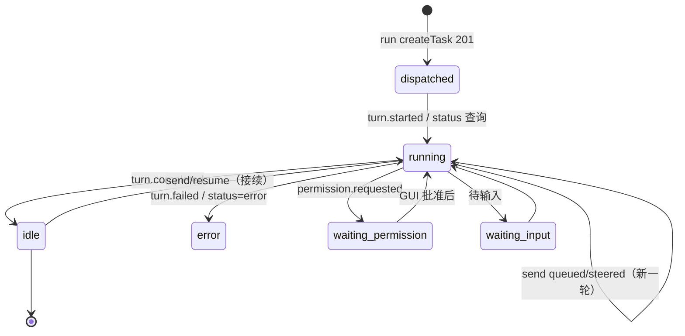

# zcode-sub 技术 Spec — 桥接程序：把 ZCode 桌面版当 Claude Code 的子代理用

> 单仓库详细技术规范。遵循 `spec写作纪律.md`：零上下文可动手、RFC 2119、无占位符。
> **传输层为契约 v2「ZCode 本机任务 API」**（2026-10-27 方案变更，见 §14 决策记录）；上游事实的家：`engineering-context/dependencies/ZCode/bots-webhook.md`（v1 调查结论，含仍被引用的会话语义）与本 spec §3。

## 0. 阅读导引（MUST，前置）

- **一句话目的**：提供 CLI（`zcode-sub`），让 Claude Code 像 dwc-sub 一样把任务派给 ZCode 桌面版里的**普通对话**执行——多对话并行、运行中可补充消息（排队/引导）、取实时事件与最终回复；任务在 ZCode GUI 实时可见、可在 GUI 继续操作。
- **端到端场景**：
  1. `zcode-sub run "<任务>" --cwd <工作区>`：CLI POST `/api/tasks` 在该工作区新建对话并发首条 prompt → stdout 一行 JSON（name/taskId）；ZCode GUI 出现新对话开始执行。
  2. Claude Code 后台 `zcode-sub wait <name>`：长轮询 `/events`——出现 `assistant.message`/`turn.completed`/`turn.failed`/`permission.requested` 或本地信箱 reply_to_parent 新行即打印并退出；`permission.requested` 提示去 GUI 处理。
  3. 运行中 `zcode-sub send <name> "<补充>"`：POST `/messages`，delivery=auto（运行中的去向由会话 follow-up mode 决定，GUI 默认排队；要即时打断用 `--steer`）→ 打印应答 `delivery`+commandId；`--steer` 的应答 `steered` 仅为受理，注入结果以事件流为准（`input.steered`→`steer.injected`/`steer.fellBack`）。
  4. `zcode-sub result <name>`：GET 任务 → running 明确说在跑；终态打印 status + lastAssistantText。
  5. 异常：token 不符 401 / Host 不符 403 → `zcode_unauthorized`；workspace 未在 ZCode 打开 → 409 `zcode_workspace_not_open`。
- **核心流程图**：
  ```mermaid
  flowchart TD
    A[zcode-sub CLI] -->|Bearer token, 127.0.0.1:port| B[ZCode 本机任务 API<br/>契约 v2]
    B --> C[IZCodeTaskService<br/>createTask/sendPrompt/queue/steer]
    C --> D[ZCode GUI 普通对话<br/>多任务并行]
    A -->|wait: GET events 长轮询| B
    E[zcode-sub mcp<br/>ZCode 拉起, reply_to_parent] -->|追加写| F[(mailboxes/name.jsonl)]
    A -->|wait: 读新行| F
  ```
- **决策表**：
  | 输入 / 状态 | 条件 | 走向 / 处置 | 结果 |
  |---|---|---|---|
  | `run` | POST /api/tasks 201 | 登记映射 | stdout 一行 JSON |
  | `run` | 409 workspace_not_open | 报错 | exit 3 + 提示先在 ZCode 打开工作区 |
  | `run` | name 已存在 | 拒绝 | exit 7（换名） |
  | `send`（运行中） | delivery=auto（默认，去向由会话 follow-up mode 决定） | POST messages | 打印 queued/steered + commandId（steer 应答=受理，结果以 steer.injected / steer.fellBack 事件为准） |
  | `send`/`resume`（空闲） | — | POST messages | 打印 sent（即接续上一轮对话） |
  | `resume`（running/waiting_*） | — | 拒绝 | exit 4，提示运行中补充用 send |
  | `wait` | events 有新事件或信箱有新行 | 打印并退出 | exit 0 |
  | `wait` | events 返回 resync | 打印「改用 result 轮询」提示（GET 状态落本地缓存） | exit 0 |
  | `wait` | 超时 | TIMEOUT | exit 2 |
  | `result` | status=running/waiting_* | 明确说在跑（waiting_permission 提示 GUI） | exit 0 |
  | `result` | idle/error | 打印 status+lastAssistantText | exit 0 |

## 1. 范围
- 本仓库做什么：CLI `zcode-sub`（Node ≥22、ESM、零运行时依赖）消费 ZCode 本机任务 API（契约 v2）；name→taskId 映射与信箱；stdio MCP server（`reply_to_parent` 由 ZCode 拉起、直接写状态目录信箱）；假 ZCode v2 全链路测试；真机冒烟脚本；Claude Code Skill；README。
- **不做什么**：不改 ZCode 代码（API 由子任务 A 提供）；不做 PR；不全局安装；不实现 daemon（v2 为拉模式，无接收进程需求，见 D-v2-03）；不通过 API 批权限（permission.requested 只提示去 GUI，契约 v2 同口径）；不依赖可选的 `GET /api/tasks` 列表端点（list 用本地记录）。
- 依赖的上游：契约 v2（全文见派发方任务书，摘要进 §3）；ZCode `IZCodeTaskService` 语义（A 桥接，B 不直接依赖）。
- **既有系统清单**：
  | 既有模块 / 机制 | 从哪知道它的 | 本次可能怎么碰到 | 卡片补了吗 |
  |---|---|---|---|
  | ZCode 本机任务 API（契约 v2） | 派发任务书（A 实现中） | 全部命令的传输层 | v2 契约非源码事实，登记在本 spec §3；A 合入后补卡 |
  | GUI busy 输入 delivery 语义（startNow/queue/guide；guide 最终 steer 或回退 queue 由命令层裁决；不带 requestedDelivery 时按会话 follow-up mode 裁决，默认 queue） | `packages/ui/src/v4/ConversationComposer.tsx:224-225,1320-1325`、`packages/ui/src/v4/composer/followupModeSettings.ts:8` | send `--steer/--queue/auto` 的语义对齐 | 已补 `dependencies/ZCode/bots-webhook.md`（会话语义节） |
  | ZCode 开关文件与应用配置目录 | `packages/services/src/paths.ts:37-58` + 契约 v2 第 1 条 | setup 写 `local-task-api.json` | 同上 |
  | MCP stdio 配置（command/args/env） | `apps/zcode-cli/docs/usage/07-mcp.md`、`packages/shared/src/mcp.ts:31-35` | `zcode-sub mcp` 配进 ZCode | 同上 |
  | dwc-sub（体验参照，只读） | `dwc-sub --help` | 命令名与输出风格 | 非代码依赖 |

### 1.1 功能需求（MUST 编号）

| 编号 | 需求 |
|---|---|
| FR-001 | `zcode-sub setup`：健康检查 `GET /health`（校验 `api=="zcode-local-task-api"`、`version==2`）；开关文件 `<dataBaseDir>/.zcode/v2/local-task-api.json` 不存在或无 token 时生成 token（≥32 字节随机）以 0600 写入 `{"enabled":true,"port":47821,"token":...}` 并提示需重启 ZCode；已存在且 enabled 时读回 token/port 存桥接 config；打印 MCP 配置步骤与授权提示（状态目录/ZCode 配置目录不可写时提示 `dwc grant <目录>`，2026-10-27 起两者均已授权，提示按实测可写性输出） |
| FR-002 | 状态层：`config.json` v2 `{apiPort, token}`；任务登记为每任务一分片 `tasks/<name>.json`（`{taskId,workspacePath,createdAt,lastStatus,eventsSeq,clientRequestId?,steerCommandIds?}`，`wx` 独占创建，读侧聚合；`steerCommandIds` 为本 CLI 各次 steer 受理的对账键，`appendSteerCommandId` 幂等追加、分片缺失/损坏时不写）；name 沿用 `[A-Za-z0-9._-]+` 校验且与既有任务重名时拒绝 |
| FR-003 | `zcode-sub run "<任务>" --cwd <绝对路径> [--name <名>] [--mode <模式>] [--model <providerId/modelId>] [--thought <档位>]`：mode 取值 `--mode` > `config.defaultMode` > **默认 `yolo`（完全访问，用户拍板 D-v2-17）**，非法枚举本地拒绝 exit 1；modelSelection 取值 `--model/--thought` > `config.defaultModel`（同形体）> **不带（用 ZCode 默认）**（FR-024 预校验）；本地重名预查（已登记名 exit 7、不触上游；EEXIST 兜并发竞态）→ `POST /api/tasks {workspacePath, prompt, title:name, clientRequestId, mode, modelSelection?}`；prompt MUST 含子代理身份说明（task 名、reply_to_parent 用法、最终总结要求）；stdout 一行 JSON（name/taskId/status/workspacePath/clientRequestId/warning?）；409 → `zcode_workspace_not_open` exit 3 |
| FR-004 | `zcode-sub send <name> "<消息>" [--steer\|--queue\|--interrupt]`：`--interrupt` = 先 `POST stop` → 有界等待（`ZCODE_SUB_INTERRUPT_TIMEOUT_MS` 默认 15s，500ms 轮询）回 idle/error → 作为新一轮发送（auto/sent）并输出「已截断当前生成，未完成内容丢弃」，超限 exit 4 且消息不发送，与 --steer/--queue 互斥（D-v2-22）；其余 delivery 走 `POST /api/tasks/:id/messages {text, delivery:"auto"\|"steer"\|"queue", clientRequestId}`（默认 auto 在运行中的去向由会话 follow-up mode 决定，GUI 默认排队；`--steer` 为 ZCode 原生引导——当前步骤结束时注入，长文本生成可能等较久，要可靠立即改向用 `--interrupt`；**send/resume 均生成 `zsub-<uuid>` 幂等键**——网络失败同键安全重试一次，与 run 同口径）；打印 `{delivery: sent\|queued\|steered, commandId?}`——`steered` 仅为受理，CLI 附提示注入结果以事件流为准（**成功判据是 steer.injected/steer.fellBack，不依赖 input.steered**——上游 3.16.2 已知丢事件问题，D-v2-18 注）；**空闲任务收到 --steer 上游按实际去向应答 `sent`**（透传如实显示，无受理提示、不记对账键）；应答 `steered` 且带 commandId 时记入分片 `steerCommandIds` |
| FR-005 | `zcode-sub wait <name> [--timeout 秒]`：循环 = 查信箱新行 → 无则 `GET /events?after=<eventsSeq>&waitMs=` 长轮询（waitMs=min(30000, 剩余超时)；resync 时 GET 任务并打印溢出提示）；事件批到达后**再读一次信箱**，把游标后 reply 行与事件按时间（at/ts）先后合并打印（真机轮修：reply_to_parent 常早于 assistant.message 写入，同轮不合并会漏到下次 wait；同毫秒事件在前；合并流统一受批级总量闸）；新事件（turn.started/assistant.message/turn.completed/turn.failed/permission.requested/input.queued/input.steered/steer.injected/steer.fellBack）或信箱新 reply 行 → 打印（permission.requested 附「请在 ZCode GUI 处理」；input.steered 按本地对账键分「你的引导已受理（commandId=…）」/「来自 GUI 侧的引导（commandId=…）」——**该事件可能不出现**（上游 3.16.2 桌面端丢弃 CLI turn.steerQueued，A 在修），引导结果以 steer.injected/steer.fellBack 为准；steer.fellBack 附「引导被降级/拒绝，原因…，消息将按排队处理或需重发」）→ 推进游标 → exit 0；超时 TIMEOUT exit 2。三种 steer 事件只打印，不参与 lastStatus 推导（终态仍只认 turn.completed/turn.failed） |
| FR-006 | `zcode-sub result <name>`：`GET /api/tasks/:id`；status ∈ running/waiting_permission/waiting_input → 明确说在跑（waiting_* 附 GUI 提示）；idle/error → 打印 status 与 lastAssistantText 全文 |
| FR-007 | `zcode-sub resume <name> "<继续文本>"`：先 GET，空闲才 POST messages（即接续对话）；running/waiting_* → 拒绝并提示运行中补充用 send |
| FR-008 | `zcode-sub stop <name>`：`POST /api/tasks/:id/stop`，打印结果 |
| FR-009 | `zcode-sub list [--json]`：本地任务分片聚合（name/taskId/lastStatus/createdAt/workspacePath） |
| FR-010 | `zcode-sub mcp`：stdio MCP server；`reply_to_parent(task, message)` 以追加写（单行 JSON，`O_APPEND`）直接写 `ZCODE_SUB_HOME/mailboxes/<task>.jsonl`；task 必须已在本地分片登记（tasks/<name>.json，否则 isError 文本告知任务名）；信箱并发安全 = 只有 MCP 进程写、CLI 只读（行级游标） |
| FR-011 | 假 ZCode v2 测试（node:test）：并行两任务互不干扰、运行中 send 得 queued/steered（steer 受理**不自产事件**，注入结果由控制方法投影 `input.steered`+`steer.injected`/`steer.fellBack`）、**messages clientRequestId 同键重试回首次应答且不双发、非法（>200/空串）400**、**空闲 --steer 应答 sent 且无 steer 事件**、空闲 send/resume 得 sent、stop、events 长轮询（含挂起后到达）与 resync、401/403、409、reply_to_parent 进信箱并被 wait 返回、wait 打印三种 steer 事件（**input.steered 按本地对账键分「你的引导已受理」/「来自 GUI 侧的引导」两种文案**）且 fellBack 不改 lastStatus、setup 开关文件生成/读回（临时 ZCODE_DATA_BASE_DIR） |
| FR-012 | 真机冒烟 `scripts/smoke-real-zcode.sh`：按 v2 步骤断言 |
| FR-013 | Skill `skill/zcode-sub/SKILL.md` 按 v2 更新（并行、send 语义、permission 提示） |
| FR-014 | README 按 v2 更新（安装、setup、命令、边界） |
| FR-015 | 删除 v1 残留：`src/daemon.js`、`src/ensure.js`、`src/ingress.js`、v1 fake-zcode、bind/new/status/stop 文本命令逻辑、`bot-webhook-ingress.json` 读写、config 的 botId/secret/userId/daemonPort 字段 |
| FR-023（Skill 评审轮） | CLI 工具性：`--version`（读 package.json，exit 0）；未知参数按命令白名单报用法错误（exit 1，不再静默忽略）；USAGE 扩充承接从 SKILL.md 下沉的细节（mode 11 值枚举、9 类事件、--timeout 默认 600、环境变量表）；setup 遇 HOME 重定向的提示直接给 shim 示例与 `ZCODE_SUB_HOME`/`ZCODE_DATA_BASE_DIR` 两个变量的含义 |
| FR-024（模型选择轮） | `zcode-sub models [--cwd <绝对路径>] [--json]`：调 `GET /api/models`，文本表列 providerId/modelId/thoughtLevels/默认标记（preferred 命中 `*`）、--json 原样，**409 workspace_not_open → exit 3（与 createTask 同口径，评审五轮修）**；`zcode-sub model <name> <providerId/modelId> [--thought <档位>]`：本地预校验后 `POST /api/tasks/:id/model`（带分片 workspacePath 与 clientRequestId），成功打印「已切换模型 …（下一轮生效）」；**本地预校验**：带 modelSelection 的 run/model 先 GET /api/models，模型不存在/档位非法/模型无档位 → `zcode_model_invalid` exit 1 并列出可选值（档位错误文案给脱困路径：显式 --thought 覆盖/改 config）；`resolveModelSelection`：`--model <providerId/modelId>`（格式非法用法错误）与 `--thought` 合成，优先级 flags > `config.defaultModel`，**defaultModel 的档位仅在未传 --model 或 --model 与 defaultModel 同模型时继承（换模型不继承，评审五轮修）**，最终无 providerId/modelId 则不带、--thought 无模型或无值时用法错误；**未指定档位且模型有档位列表时自动补默认档位（max 优先 → defaultThoughtLevel → 末档，D-v2-21），stderr 打印实际档位**（真机实锤：有档位的模型不带 reasoningLevel 会被上游拒绝建会话） |
| FR-016 | 并发派发上限（评审门第一轮拍板）：run 前对本地登记中非终态（dispatched/running/waiting_permission/waiting_input/未知值）任务逐个 GET 刷新后计数，达到上限拒绝派发；上限默认 4，环境变量 `ZCODE_SUB_MAX_RUNNING` 可调；新错误码 `zcode_too_many_running`（退出码 8）。刷新返回 404 的任务视为已在 GUI 删除，本地置 `error` 终态释放额度（评审二轮 N2）；上限为尽力检查，多进程同时派发瞬间可能超出（N4） |
| FR-017 | 副作用 POST 的重试纪律：**无幂等键的 POST 不重试**；带 `clientRequestId` 的 create/messages/setModel 同键安全重试一次（run/send/resume/model 均生成 `zsub-<uuid>`）；stop 不带键不重试，失败报 `zcode_api_unreachable` 并提示「任务可能已创建/已执行，先 list / GUI 核对」；GET 保留一次重试（评审二轮按上游新增 clientRequestId 撤回一轮的保守「POST 一律不重试」，r6 起扩至 messages、模型轮扩至 setModel——D-v2-10/19/20） |
| FR-018 | 任务登记并发安全：每任务一分片文件 `<home>/tasks/<name>.json`（registerTask 用 `wx` 独占创建防同名竞态）；单分片损坏时先备份 `.corrupt-<ts>` 再按不存在处理 |
| FR-019 | 所有按 taskId 的 API 请求携带登记的 workspacePath（GET 走 query、POST 进 body）——ZCode 重启丢归属表时据此路由（契约对齐第 4 条）；wait 处理事件 seq 回退（ZCode 重启后缓冲清空、nextSeq 变小）：重置本地游标并继续等待，不当新事件 |
| FR-020 | wait 输出体量双闸：单条事件 text/error/summary 超 2000 字符只打印前段并注明总长（全文用 result/GUI）；单次 wait 输出总量上限 20000 字符，超出后剩余事件/reply 降级为一行「剩余 N 条略过 + 获取方式」，游标照常推进不重放（评审二轮 N1）；单条 reply 超 20000 字符同样降级为前 2000 字符 + 总长 + 信箱文件路径指针（与事件单条截断同构，评审三轮 R3-1），未超限的单条 reply 保持全文；result 保持全文 |
| FR-021 | setup `--api-port` 与已存在开关文件端口冲突时明确报错（以开关文件为准、告知手工修改方式），exit 1，其余步骤继续 |
| FR-022 | `ZCODE_SUB_DEBUG=1` 时 API 请求/响应摘要追加 `<ZCODE_SUB_HOME>/debug.log`（method/path/status/长度，不含 token 与 prompt 正文） |

## 2. 数据模型 / 数据结构

**稳定标识**：`name`（本地任务键：信箱文件名、任务分片文件名 tasks/<name>.json、reply_to_parent 参数）与上游 `taskId`（ZCode 对话标识）的映射存每任务一分片（读侧聚合）。上游输入归一化：name 同 v1 规则 `[A-Za-z0-9._-]+`。

`ZCODE_SUB_HOME`（env 覆盖；默认 `os.userInfo().homedir + "/.zcode-sub"`，MUST NOT 用 `os.homedir()`）：

```jsonc
// config.json（0600）
{ "apiPort": 47821, "token": "<与开关文件一致>" }

// tasks/<name>.json —— 每任务一分片；registerTask 以 wx 独占创建（防同名竞态），
// 读侧（loadTasks/getTask/listTaskNames）聚合目录；损坏分片在重登记时备份 .corrupt-<ts> 后覆盖
{ "taskId": "<ZCode taskId>",
  "workspacePath": "/abs/path",
  "createdAt": 1790000000000,
  "lastStatus": "running|idle|waiting_permission|waiting_input|error|dispatched",
  "eventsSeq": 42,           // wait 消费到的上游事件 seq
  "clientRequestId": "zsub-…" // run 生成的建任务幂等键（可选）

// mailboxes/<name>.jsonl —— 只有 MCP reply_to_parent 追加；CLI 只读
{"ts":1790000123000,"kind":"reply","text":"..."}
// mailboxes/<name>.cursor —— 已读行数（十进制一行）
```

v1 的 seq/dispatch/status/notice 行语义删除；daemon.json、daemon.log、config 的 botId/secret/userId/daemonPort 删除。

## 3. 接口契约

| 接口 | 入参 | 出参 | 调用方 | 版本 |
|---|---|---|---|---|
| `GET /health`（上游） | — | `{ok,api:"zcode-local-task-api",version:2,zcodeVersion}` | setup | v2 |
| `POST /api/tasks`（上游） | Bearer；`{workspacePath,prompt,mode?,title?,clientRequestId?,modelSelection?}` | 201 `{taskId}` 或 `{taskId,warning:"first_prompt_failed"}`（部分失败，任务已建）；同 `clientRequestId` 去重命中 200 返回同一 `{taskId}`；mode 非法 400；modelSelection 非法（多余键/空串）400；409 `{error:"workspace_not_open"}` | run | v2 |
| `GET /api/models`（上游） | `?workspacePath=`（鉴权/409 语义与其它端点一致） | `{providers:[{providerId,displayName,models:[{modelId,displayName,thoughtLevels,isDefault}]}],preferred?}`（preferred 形状即 modelSelection，可原样回传） | models/run/model 预校验 | v2 |
| `POST /api/tasks/:id/model`（上游） | `{modelSelection(必填，同 strict 400),workspacePath?,clientRequestId?}` | 200 `{ok:true}`；运行中允许；clientRequestId 幂等为独立 model 命名空间（与 send/create 隔离）；404 | model | v2 |
| `POST /api/tasks/:id/messages`（上游） | `{text,delivery?:"auto"\|"queue"\|"steer",clientRequestId?}`（auto 不带 requestedDelivery，CLI 按会话 follow-up mode 裁决，GUI 默认 queue；steer→guide 与 GUI 同一条 v4 sendText 链路；clientRequestId 可选 1..200、每任务命名空间 10 分钟去重、命中回首次应答含 commandId 原值、空串 400） | 202 `{delivery:"sent"\|"queued"\|"steered",commandId?}`（steered 仅为受理；注入结果以事件流 `input.steered`→`steer.injected`/`steer.fellBack` 为准；**空闲任务收到 steer 按实际去向应答 sent、无 steer 事件**）；404 | send/resume | v2 |
| `POST /api/tasks/:id/stop`（上游） | — | 202 | stop | v2 |
| `GET /api/tasks/:id`（上游） | — | `{taskId,workspacePath,title,status,turnCount,lastAssistantText,updatedAt}` | result/resume/wait(resync) | v2 |
| `GET /api/tasks/:id/events?after=&waitMs=`（上游） | after=seq, waitMs 0..30000 | `{events:[{seq,type,at,...}],nextSeq}`；溢出 `{resync:true}` | wait | v2 |
| CLI stdout（run） | — | 一行 JSON `{name,taskId,status:"dispatched",workspacePath,clientRequestId,warning?}`（warning 见偏离 #13；clientRequestId 供对账孤儿任务） | Claude Code | v2 |

**外部集成契约（ZCode 本机任务 API）**：
- REQUIRED 操作如上表；鉴权 `Authorization: Bearer <token>`（常量时间比较在 A 侧）；`Host` 头校验 403；body 仅 `application/json`、上限 16 MiB；请求超时：普通 10s，events 长轮询 waitMs+5s。
- 归一化：status 五值透传不翻译；delivery 结果透传；事件按 type 分发打印。
- 机器可读错误码（stderr+退出码统一，闭集）：`zcode_api_unreachable`（连不上 API 或 **wait 超时 TIMEOUT**，2）、`zcode_workspace_not_open`（409：未打开或远端工作区，3）、`zcode_send_failed`（messages/stop/result/events 等按 taskId 请求的 4xx/5xx 非 401/403/409，含 404 任务不存在，**及运行中 resume 被拒**，4）、`zcode_unauthorized`（401/403，5）、`zcode_name_invalid`（名字非法，7）/`zcode_name_taken`（重名，7）、`zcode_too_many_running`（非终态任务达上限，8）、`zcode_model_invalid`（模型/思考档位不在 /api/models 可用列表，1——报错列出可选值）、`zcode_workspace_path_invalid`（400 workspace_path_invalid：工作区路径非法，1——A 自动打开工作区交付后的预留映射，D-v2-23）；409 家族 `workspace_open_timeout`（打开工作区超时）并入 `zcode_workspace_not_open`（exit 3，文案区分）。仅内部使用不占退出码：`zcode_not_configured`、`zcode_task_not_found`（本地无此任务）、`zcode_create_failed`（建任务异常响应）、`zcode_health_mismatch`、`zcode_task_busy_for_resume`（归入 4）。
- **本集成不做哪些写操作**：不批权限、不写 ZCode 数据文件（开关文件按契约第 1 条「由用户或桥接程序 setup 写入」，仅 setup 显式执行）。
- **B 依赖的字段级契约（与 A 实装对齐后的终值）**：
  - `events[i]`：`seq`（每任务从 1 单调，缓冲 500，溢出 `{resync:true}`）、`at`（毫秒）、`type` ∈ turn.started / assistant.message / turn.completed / turn.failed / permission.requested / input.queued / input.steered / steer.injected / steer.fellBack；payload 字段 `turn.started{turnId}`、`assistant.message{text}`、`turn.completed{text}`（停止后 text 可为空）、`turn.failed{error}`、`permission.requested{summary}`、`input.queued{commandId}`、`input.steered{commandId}`（由 CLI `turn_steer_queued` 投影产生——steer 受理不再由 API 自产事件；commandId 与 202 应答 commandId 相等，是对账键——同一任务也可能收到 GUI 侧引导的同型事件，B 按 commandId 严格对账：在本地分片 `steerCommandIds` 里→「你的引导已受理」，不在→「来自 GUI 侧的引导」）、`steer.injected`（由 `turn_steer_status` drained 投影——引导已注入当前轮，无额外 payload）、`steer.fellBack{error}`（由 `turn_steer_status` discarded/rejected 投影——引导被降级/拒绝）。
  - `POST /api/tasks` 的 `title` 传 name；可选 `clientRequestId` 为去重幂等键（**1..200 字符、10 分钟窗口**，命中返回同一 taskId、状态码 200）——run 生成 `zsub-<uuid>`（41 字符）并记入本地分片，重试间隔毫秒级远在窗口内；`mode` 为 11 值枚举（default/yolo/guarded/plan/edit/acceptEdits/auto/dontAsk/bypassPermissions/autoEdit/build），非法 400——B 默认传 `yolo`、`--mode`/`config.defaultMode` 可覆盖（D-v2-17，本地预校验非法值）；`turnCount` 为快照中 assistant 消息条数；`modelSelection` = `{providerId, modelId, options?:{reasoningLevel}}`（strict：非空串、多余键/空串 400；`GET /api/models` 的 `preferred` 对象可原样回传；`GET /api/models` 的 thoughtLevels 缺失视为 `[]`=该模型无档位）。
  - **create 部分失败**（偏离 #13）：首条 prompt 发送失败仍回 `201 {taskId, warning:"first_prompt_failed"}`——B 照常登记，stdout JSON 带 `warning` 字段、stderr 提示用 send 补发、退出码 0（任务已建，非零会误判整轮失败）。
  - **op 异常**（偏离 #14）：Host 退出时在飞请求结清为 `503 {error:"unavailable_host"}`——B 视为暂态：GET/带幂等键的 createTask 重试一次，其余 POST 不重试，最终失败报 `zcode_api_unreachable`（exit 2，文案带 unavailable_host）。
  - `GET /api/tasks/:id` 的 `lastAssistantText` 为最近一条完整助手回复（idle 时即最终回复）。
  - 停止后上游发 `turn.completed`（text 空），无独立 stopped 状态/事件——result 以 status（idle）为准。
  - **所有按 taskId 的端点接受可选 workspacePath**（GET `?workspacePath=`、POST body）——ZCode 重启丢归属表时据此路由并校验；B 一律携带。
  - ZCode 重启后 events 缓冲清空、seq 从当前继续——可能小于 B 本地游标（回退），B 重置游标继续等待。
  - 校验顺序：路径级 404/405（鉴权前）→ Host 403 → Bearer 401 → Content-Type 415 → 大小 413。
  - events 的 `nextSeq` 在无新事件时等于 after；`resync:true` 时不含 events。

## 4. 核心逻辑 / 流程

### 4.1 setup
```
dataBaseDir = env ZCODE_DATA_BASE_DIR ?? userInfo().homedir（对齐 paths.ts:37-43）
switchFile = <dataBaseDir>/.zcode/v2/local-task-api.json
已存在且 enabled 且有 token → 读回 {port, token} 存 config
否则 → 生成 token（randomBytes(32).toString("hex")），0600 写 {"enabled":true,"port":config.apiPort,"token"}，
      打印「已写入开关文件，需重启 ZCode 生效」
（目录不可写 → 打印脱敏配置示例（token 仅露前 4 位）与 dwc grant 提示，不绕过——同 Invariant 2；状态目录可写性探测在 setup 最前置一处，见 FR-001）
GET /health（api/version 校验）→ 打印结果与排查提示
ensureHome 可写性实测：不可写时按是否设置 ZCODE_SUB_HOME 分支——未设（HOME 被重定向）给 shim 模板与 ZCODE_SUB_HOME/ZCODE_DATA_BASE_DIR 两变量含义（FR-023）；已设提示对该目录授权（本机环境命令 dwc grant）
打印 MCP 配置片段（command=node, args=[<pkg>/bin/zcode-sub.js, mcp],
  env={ZCODE_SUB_HOME:<abs>, ZCODE_SUB_TOKEN:不需要→删除}）——v2 MCP 直写信箱，只需 ZCODE_SUB_HOME
```

### 4.2 API 客户端（src/api.js）
```
apiFetch(config, path, {method, body, timeoutMs})：
  headers: Authorization: Bearer <token>, content-type: application/json
  401/403 → zcode_unauthorized；网络失败：GET 重试 1 次，无幂等键 POST 不重试（FR-017）→ zcode_api_unreachable
createTask(config, {workspacePath, prompt, title, mode?, modelSelection?, clientRequestId}) → {taskId, warning?}（409 → zcode_workspace_not_open；带键时网络失败同键重试一次）
sendMessage(config, taskId, text, delivery?, workspacePath?, clientRequestId?) → {delivery, commandId?}
stopTask(config, taskId, workspacePath?)
getTask(config, taskId, workspacePath?) → {status, lastAssistantText, ...}
getEvents(config, taskId, after, waitMs, workspacePath?) → {events, nextSeq} | {resync: true}
listModels(config, workspacePath?) → {providers, preferred?}（409 workspace_not_open → zcode_workspace_not_open，与 createTask 同口径）
setModel(config, taskId, modelSelection, workspacePath?, clientRequestId?) → {ok:true}（带键时同键重试一次）
```

### 4.3 run / send / resume / stop / result / wait / list
```
run: name 校验 → 本地重名预查（getTask 已存在 → exit 7，不触上游）→ 并发上限检查（FR-016：本地非终态任务逐个 GET 刷新后计数，≥上限 exit 8）
    → createTask → 分片登记（eventsSeq=0, lastStatus="dispatched"）
    prompt 模板：【zcode-sub 委托】任务名 <name>…工作目录 <cwd>…reply_to_parent 说明…最终总结要求 + 任务正文
send: 映射查 taskId → sendMessage(text, delivery, workspacePath)
    打印投递结果（sent/queued/steered + commandId）
resume: getTask(taskId, workspacePath) → status=="idle" 才 sendMessage（打印 sent）；running/waiting_* → exit 4 提示用 send
stop: stopTask(taskId, workspacePath) → 打印「已请求停止」
result: getTask(taskId, workspacePath) → 更新 lastStatus
    running/waiting_* → 「还在跑」+ waiting_permission/waiting_input 附「请在 ZCode GUI 处理」
    idle/error → 「状态：<status>」+ lastAssistantText 全文；未知值 → 「状态未知（原文 …），按非终态处理」
wait: deadline=now+timeout(默认600s)
  loop:
    信箱新行（行号>cursor）→ 打印 [reply] text（单条超 20000 降级前 2000 字符+总长+信箱路径，FR-020）→ cursor 推进 → exit 0
    eventsWait = clamp(min(30s, 剩余), 0, 30s)；剩余≤0 → TIMEOUT exit 2
    getEvents(taskId, eventsSeq, eventsWait*1000, workspacePath)（HTTP≥400 抛 zcode_send_failed）
      resync → 打印「事件缓冲溢出，改用 result 轮询」→ exit 0
      空且 nextSeq < after → 游标回退：eventsSeq=nextSeq、打印「事件序列已重置（ZCode 可能重启）」→ 继续 loop
      events 非空 → 逐条打印（正文>2000 字符截断+注明总长）→ eventsSeq=nextSeq → exit 0
      空 → 继续 loop（回来先查信箱）
  打印格式：`[<type>] <text|error|summary>`；permission.requested 后附一行「⏳ 请在 ZCode GUI 处理该权限请求」
list: 本地任务表（name/taskId 后 8 位（真机轮改，前缀同为 session_ 无区分度）/lastStatus/createdAt/workspacePath）
```

### 4.4 MCP（src/mcp.js 改造）
```
env：ZCODE_SUB_HOME（配置片段写绝对路径；缺省回退 userInfo().homedir/.zcode-sub）
tools/call reply_to_parent → task 在本地分片登记中？（不在 → isError 文本）
  → appendFileSync(<home>/mailboxes/<task>.jsonl, JSON.stringify({ts,kind:"reply",text})+"\n")
  → 返回「已投递给 <task>」；文件写失败 → isError 文本
并发说明：仅 MCP 进程写、CLI 只读；单行 append 在 POSIX 下 O_APPEND 原子
```

**设计自检**：daemon 删除（无推送接收方）；信箱只剩 reply（读方游标=行号）；eventsSeq 只由 wait 推进。每个概念 → FR 对照齐。无多 bot 池、无重试策略配置、无权限 API（YAGNI）。

**备选方案**：wait 可选 a) 纯 events 轮询 + 信箱独立命令 b) wait 统一两源。选 b（Claude Code 一次 wait 即可两源都醒）；假设「events 长轮询在无事件时挂起不耗资源」由 A 的实现保证（契约 waitMs 语义）。

## 5. 错误处理 / 降级 / 失败模型
| 错误类 | 处置 |
|---|---|
| API 连不上 / health 不通 | `zcode_api_unreachable`（2），提示 ZCode 未启动/开关文件/端口 |
| 401/403 | `zcode_unauthorized`（5），提示重跑 setup 对齐 token |
| 409 workspace_not_open | `zcode_workspace_not_open`（3），提示先在 ZCode 打开该工作区 |
| messages/stop 404 或 5xx | `zcode_send_failed`（4），提示任务可能已在 GUI 被删除 |
| name 非法 → `zcode_name_invalid`（7）；重名 → `zcode_name_taken`（7） |
| events resync | 打印状态提示退出，不猜事件内容 |
| 信箱写失败（MCP 侧） | isError 文本返回子代理，不崩 server |
| status 未知值 | 原样打印（不映射），按非终态处理（result 说「状态未知，原文 …」） |

**失败模型**：
| 失败分类 | 恢复行为 | 重启后存活性 | 干预点 |
|---|---|---|---|
| ZCode 重启 | API 短暂不可达 → unreachable；任务在 ZCode 侧持久 | 任务分片/信箱全存活 | 重试即可 |
| events 缓冲溢出 | resync → GET task | eventsSeq 失效但不破坏任务 | GUI 看全程 |
| MCP server 崩溃 | ZCode 侧重启拉起（MCP 配置常驻） | 信箱 jsonl 存活 | ZCode 日志 |

## 6. 安全 / 鉴权 / 配置 / 不变量
- 信任边界：CLI/MCP 只与 127.0.0.1 的 ZCode API 通信；token 存两处（开关文件 0600、桥接 config 0600），日志与 stdout MUST NOT 打印 token 全文（≤4 位）。
- 配置管线：`ZCODE_SUB_HOME`（目录）→ `ZCODE_DATA_BASE_DIR`（开关文件定位）→ config.json。无动态 reload。
- **配置 Cheat Sheet**：
  | 字段 | 类型 | REQUIRED | 默认 | 动态 |
  |---|---|---|---|---|
  | ZCODE_SUB_HOME | env | 否 | `~/.zcode-sub`（userInfo().homedir） | 否 |
  | ZCODE_DATA_BASE_DIR | env | 否 | userInfo().homedir | 否 |
  | ZCODE_SUB_MAX_RUNNING | env | 否 | 4（非终态任务并发上限） | 每次 run 读取 |
  | ZCODE_SUB_DEBUG | env | 否 | 关（=1 写 debug.log 摘要） | 即时 |
  | config.apiPort | int | 否 | 47821；开关文件已存在时以它为准（`--api-port` 冲突即报错 exit 1，不覆盖用户侧文件——FR-021） | setup 时 |
  | config.token | string | setup 生成 | — | — |
  | config.defaultMode | string | 否 | yolo（run 的 --mode > 此值 > yolo） | — |
  | config.defaultModel | object（同 modelSelection 形体） | 否 | 不带（用 ZCode 默认；--model/--thought > 此值） | — |
- **安全不变量**：
  ```
  Invariant 1: CLI/MCP 只请求 127.0.0.1，不发起任何非本机连接
  - 强制机制：apiFetch 的 URL 固定 127.0.0.1:<port>
  - 违反时：不会发生（无配置面）
  Invariant 2: token 不进日志/stderr 全文；开关文件与 config 均 0600
  - 强制机制：打印处 slice(0,4)；写文件显式 mode 0o600
  Invariant 3: name 仅 [A-Za-z0-9._-]+，信箱与任务分片路径不逃出各自目录
  - 强制机制：run/registerTask 校验 + MCP reply 前校验任务分片登记名
  ```

## 7. 可观测性
- CLI 诊断走 stderr（错误码 + 一句人话）；默认不落日志文件（v2 无 daemon），`ZCODE_SUB_DEBUG=1` 时 API 请求/响应摘要追加 debug.log（FR-022，不含 token 与 prompt 正文）。
- 信箱 jsonl 仍是审计面（reply 行带 ts）。
- events/wait 的原始响应不打印（只打印投影后事件行）。

## 8. 兼容性 / 迁移
### 8.1 兼容取舍决策
v0.1.0（v1 webhook 方案）未交付安装，本次直接切换为 v2：config.json 结构更换、daemon/绑定流程删除、退出码 6 移除。无既有用户依赖，按不兼容处理，CHANGELOG 记 `不兼容` 条目。
### 8.2 替换清单
| 被取代物 | 类型 | 取代者 | 处置 | 保留理由 |
|---|---|---|---|---|
| `src/daemon.js` 全部 | 文件 | 无（拉模式 + MCP 直写） | 删除 | — |
| `src/ensure.js` 全部 | 文件 | 无 | 删除 | — |
| `src/ingress.js` 全部 | 文件 | `src/api.js` | 删除 | — |
| bind/new/status/stop 文本命令路径 | 代码段 | REST 调用 | 删除 | — |
| `bot-webhook-ingress.json` 读写 | 代码段 | `local-task-api.json` 读写 | 删除 | — |
| config 的 botId/secret/userId/daemonPort | 字段 | apiPort/token | 删除 | — |
| 信箱 seq/dispatch/status/notice 语义 | 数据格式 | reply-only + 行号游标 | 删除 | — |
| v1 fake-zcode | 测试 | fake-zcode v2 | 删除 | — |
### 8.3 数据迁移
无需（未发布）。旧 `~/.zcode-sub` 若有 v1 数据，setup 重建 config（tasks/mailboxes 目录沿用）。

## 9. AI 契约补充
本工具不含模型调用；prompt 模板（§4.3）是对子代理的提示词约定，改动视作接口变化，MUST 同步 FR-003 与测试断言。

## 10. 状态机（任务）

（状态以 GET /api/tasks/:id 的 status 为准；本地图 lastStatus 是缓存投影。）

## 11. 完成定义
| 编号 | 验收项 | 满足 |
|---|---|---|
| AC-001 | §0 齐全 | — |
| AC-002 | 全部命令按 §3/§4 实现，`npm test` 全绿 | FR-001~FR-010 |
| AC-003 | 错误路径（401/403/409/404/unreachable/重名/未知 status）有测试 | FR-003~007 |
| AC-004 | 并行两任务互不干扰（事件/信箱/状态各自正确）有测试 | FR-003,005 |
| AC-005 | 安全不变量 1/2/3 有强制代码（127.0.0.1 固定、0600、name 校验） | — |
| AC-006 | 配置 Cheat Sheet 与实现一致 | FR-001 |
| AC-007 | 错误码 zcode_* 全部落 stderr+退出码 | — |
| AC-008 | 假 ZCode v2 覆盖 FR-011 全场景（含长轮询挂起后到达、resync） | FR-011 |
| AC-009 | MCP 子进程管道驱动（initialize/tools/call→信箱行） | FR-010 |
| AC-010 | 冒烟脚本 v2 步骤断言清楚 | FR-012 |
| AC-011 | Skill/README v2 更新且覆盖并行与 send 语义 | FR-013,014 |
| AC-012 | v1 残留删净（§8.2 逐项：无引用、文件不存在） | FR-015 |
| AC-013 | 并发上限（默认 4 与 env 覆盖）、POST 重试纪律（带键同键重试、无键 POST 不重试）、子进程并行登记不丢、wait 截断（含单条 reply 降级）、游标回退、端口冲突、403/415/405/413、workspacePath 传递均有用例 | FR-016~FR-022 |

覆盖自查：FR-001→AC-002/003/006；FR-002→AC-002/003；FR-003→AC-002/003/004；FR-004→AC-002/008；FR-005→AC-002/004/008；FR-006→AC-002/003；FR-007→AC-002/003；FR-008→AC-002；FR-009→AC-002；FR-010→AC-002/009；FR-011→AC-008；FR-012→AC-010；FR-013→AC-011；FR-014→AC-011；FR-015→AC-012；FR-016~FR-022→AC-013；FR-023→AC-008（--version/未知参数用例）；FR-024→AC-008（models/model/预校验用例）。全覆盖。

## 12. 待澄清点
无（契约 v2 文本为准；字段假设已集中在 §3 末清单）。

## 13. 过稿记录
- 2026-10-27｜拍板人显式跳过本次（经派发任务书声明）｜v1 版。
- 2026-10-27｜方案变更由用户硬性要求驱动（多对话并行 + 运行中补充消息），派发方在变更指令中给出契约 v2 全文并指示继续；按其指示 spec 直接改、代码继续，不再过稿门。

## 14. 决策记录（含 v1 → v2 变更理由）
| # | 决策 | 方向 | 理由 |
|---|---|---|---|
| D-v2-01 | 传输层换契约 v2 | 本机任务 API（REST+长轮询），弃 webhook bot | 用户硬性要求多对话并行、运行中补消息；v1 已查实单 bot 单绑定单会话、私聊无 steer/queue（事实卡 bots-webhook.md 陷阱项）——不满足 |
| D-v2-02 | 多任务并行 | 每 run 一个 ZCode 对话，name→taskId 映射 | 契约 v2 createTask 天然支持 |
| D-v2-03 | daemon 删除 | 无常驻进程 | v2 无出站推送；events 是拉模式；MCP 由 ZCode 拉起直写信箱 |
| D-v2-04 | 信箱 reply-only | MCP 独写、CLI 只读、行号游标 | 消除跨进程 seq 竞争；O_APPEND 单行原子 |
| D-v2-05 | send 默认 auto | 与 GUI 运行中默认行为一致（不带 requestedDelivery，运行中的去向由会话 follow-up mode 裁决，GUI 默认 queue——文档写明要即时打断用 --steer） | 用户要求「像桌面端原生」；queue/steer 显式选项覆盖 |
| D-v2-06 | resume 空闲检查 | running/waiting_* 拒绝 | 「续聊」语义 = 开新一轮对话输入；运行中补充是 send 的职责，两命令不重叠 |
| D-v2-07 | list 只用本地 | 不依赖可选端点 | YAGNI；A 未承诺实现 |
| D-v2-08 | permission 只提示 | 不做 API 批权限 | 契约 v2 明确本版不做 |
| D-v2-09（评审一轮） | 并发上限 4，env 可调 | 派发者拍板；run 前 GET 刷新非终态计数，超限 exit 8 | 无上限会把父代理上下文与 ZCode 资源同时打爆 |
| D-v2-10（评审一轮立、二轮改） | 副作用 POST 重试纪律 | createTask 带 clientRequestId 幂等键、同键重试一次；其余 POST 不重试 | 一轮时上游无幂等键只能禁重试；二轮上游加 clientRequestId 后撤回保守禁令（评审二轮指令） |
| D-v2-14（评审二轮） | wait 批级输出上限 20k 字符 | 超出降级一行摘要（总量+获取方式），游标照常推进 | 防积压事件/reply 一次性灌爆父上下文（实测无闸可达 24 万字符） |
| D-v2-15（评审二轮） | 刷新 404 置 error | GUI 删除的任务在下次 run 刷新时释放并发额度 | 否则幽灵任务永久占坑、无 CLI 清理手段 |
| D-v2-16（评审二轮） | 损坏分片在重登记时备份并覆盖 | registerTask 遇 EEXIST 且分片不可解析 → 备份 .corrupt 后覆盖 | 修复「备份路径不可达、名字永久卡死」的死局 |
| D-v2-17（真机反馈，用户拍板） | run 默认 mode="yolo"（GUI『完全访问』） | 派发的子代理不再卡权限确认；--mode 与 config.defaultMode 可覆盖 | 权限请求事件（permission.requested）处理逻辑保留——非 yolo 模式或上游仍发请求时照常提示去 GUI |
| D-v2-18（真机反馈；A 侧 d4c518ba 已落地） | steer 为真打断语义 | --steer = sendPrompt 带 `requestedDelivery:"guide"`（与 GUI 同一条 v4 sendText 链路）；应答 `202 {delivery:"steered",commandId}` 仅为**受理**，注入结果以事件流回报：`input.steered{commandId}`（CLI `turn_steer_queued` 投影，API 不再自产）→ `steer.injected`（drained，已注入当前轮）/ `steer.fellBack{error}`（discarded/rejected，降级/拒绝）；wait 打印三事件、fellBack 明确告知「引导被降级/拒绝，原因…，消息将按排队处理或需重发」，lastStatus 推导不受影响。**注（真机轮）**：ZCode 3.16.2 桌面端协议校验会丢弃 CLI 的 turn.steerQueued（多 inputPresentation 字段），`input.steered` 事件目前不会到达（A 在修）——B 不依赖它判定引导成功，结果判据是 `steer.injected`/`steer.fellBack` | 用户要求真打断；受理与注入是两个时刻，必须以事件流为准；旧 enqueue+promote 近似已在 A 侧废弃 |
| D-v2-19（r6 跟进；A 侧 d2e4fd94） | messages 幂等 + 引导对账 | send/resume 生成 `zsub-<uuid>` clientRequestId（网络失败同键安全重试一次，与 createTask 同口径）；steer 受理的 commandId 记入本地分片，wait 打印 `input.steered` 时按 commandId 对账——命中「你的引导已受理」、未命中「来自 GUI 侧的引导」（GUI 侧对同一任务的引导会产生同型事件）；空闲任务 --steer 上游应答 `sent`，透传如实显示 | 上游 messages 端已支持幂等去重（偏离#12 扩展），不利用则网络重试有双投风险；对账避免把 GUI 侧引导误当自己的操作结果 |
| D-v2-20（模型选择轮；A 侧 1f04bddf） | 派发时选择模型 | run `--model <providerId/modelId>` + `--thought <档位>` 组装 create 的 `modelSelection`（strict 形体，deprecated model/thoughtLevel 不用）；`config.defaultModel` 同形体兜底；不传不带（用 ZCode 默认）；值域本地预校验（GET /api/models，非法 `zcode_model_invalid` exit 1 列可选值）；新增 `models` 查询与 `model <name>` 换模型命令（换模型运行中允许——GUI 仅 Highspeed 锁、Host 不可见；幂等独立 model 命名空间） | 上游已交付正式 modelSelection 字段与查询/换模型端点；预校验把 400 挡在本地并给使用方可选列表 |
| D-v2-21（真机反馈轮，用户拍板） | 未指定思考档位时的默认 | --model/defaultModel 有模型但无 reasoningLevel 且该模型有档位列表时，B 侧自动补默认档位：**max 优先**（在列表中）→ A 侧 `defaultThoughtLevel` 字段（将新增；缺失或不在列表跳过）→ 列表末档兜底；stderr 打印实际使用的档位 | 真机实锤：ZCode 对有档位的模型拒绝无 reasoningLevel 建会话（Reasoning level is required）；用户偏好 max（GLM-5.3 与 GLM-5.3-Flash 均支持） |
| D-v2-22（真机反馈轮，用户拍板） | send `--interrupt` 截断语义 | 先 POST stop 停止当前生成 → 有界轮询（500ms 间隔，`ZCODE_SUB_INTERRUPT_TIMEOUT_MS` 默认 15000）等回 idle/error → 消息作为新一轮发送（auto/sent，幂等键照常）；输出「已截断当前生成，未完成内容丢弃」；超限 exit 4 且消息不发送；与 `--steer`/`--queue` 互斥。`--steer` 保留为 ZCode 原生引导（当前步骤结束时注入，长文本生成时可能要等较久——如实文档）；**不依赖 `input.steered` 判定引导成功**（上游已知问题：ZCode 3.16.2 桌面端协议校验丢弃 CLI turn.steerQueued，事件暂不会到达，A 在修）——结果判据是 `steer.injected`/`steer.fellBack` | 用户需要可靠的立即改向：原生引导注入时机在步骤末尾、长生成等太久；interrupt 用停止+重发保证即时，代价是未完成内容丢弃（输出明示） |
| D-v2-23（真机反馈轮，预留） | 工作区自动打开后的新错误映射（A 在做，最终形状待发） | create/listModels 的 409 按 error 分流：`workspace_open_timeout` → `zcode_workspace_not_open`（exit 3，文案「打开该工作区超时」）；`workspace_path_invalid`（400）→ `zcode_workspace_path_invalid`（**exit 1**，用法类） | A 侧自动打开工作区交付后 409 workspace_not_open 变少、新错误出现——先映射防误报 |
| D-v2-11（评审一轮） | 任务登记分片文件 + wx 独占创建 | 单文件读改写并发实测丢 25% | 分片天然消竞争，与信箱同构 |
| D-v2-12（评审一轮） | setup 端口冲突报错不覆盖 | 开关文件是 ZCode 侧事实源 | 自动重写会让 GUI 配置静默漂移 |
| D-v2-13（契约对齐） | 所有 :taskId 请求带 workspacePath；seq 回退重置游标 | A 实装：ZCode 重启丢归属表、事件缓冲清空 | 路由兜底由调用方提供归属 |
| D-01~D-07（v1） | 见 git 历史 8645a46 版 spec | 已被 D-v2 系取代；D-04（终态以查询为准）、D-06/D-07（零依赖）精神延续 | v1 调查结论（会话语义、/status 文案、messageId 幂等）继续住在事实卡，供 v1 考古与 A 侧参考 |
