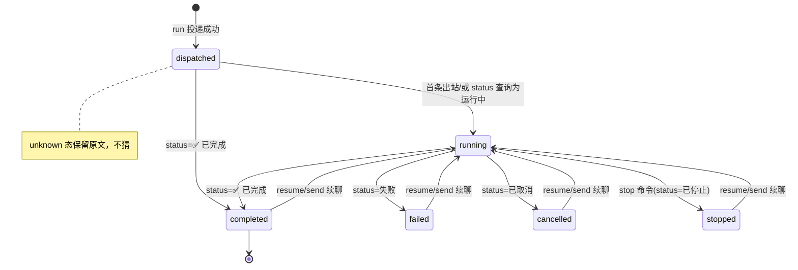

# zcode-sub 技术 Spec — 桥接程序：把 ZCode 桌面版当 Claude Code 的子代理用

> 单仓库详细技术规范。遵循 `spec写作纪律.md`：零上下文可动手、RFC 2119、无占位符。
> 上游事实的家：`engineering-context/dependencies/ZCode/bots-webhook.md`（本文引用事实带 `文件:行`，均为 2026-10-27 对 ZCode main 工作树现读所得）。

## 0. 阅读导引（MUST，前置）

- **一句话目的**：提供一个 CLI（`zcode-sub`）+ 常驻 daemon，让 Claude Code 像 dwc-sub 一样把任务派给 ZCode 桌面版里的会话执行，并取回实时消息与最终回复。
- **端到端场景**：
  1. Claude Code 跑 `zcode-sub run "<任务>" --cwd <工作区>`：桥接器确认 daemon 在听 → 查 `/status`（非运行中）→ 发 `/new` → 投递任务正文 → stdout 一行 JSON（name 等）；ZCode 在 GUI 里建任务开跑，过程与结果经出站回调推给 daemon，落进该任务信箱。
  2. Claude Code 后台跑 `zcode-sub wait <name>`：daemon 收到新出站消息（模型正文/工具摘要/错误）即唤醒打印，退出。
  3. Claude Code 跑 `zcode-sub result <name>`：桥接器发 `/status` 复核状态行——终态则打印最终回复全文；「⏳ 运行中」则明确说在跑。
  4. 异常：ZCode 未启动 / 入站端点不在 → 命令报 `zcode_ingress_unreachable`；任务运行中 `send` 被 ZCode 拒收 → 命令如实转达拒收文案。
- **核心流程图**：
  ```mermaid
  flowchart TD
    A[zcode-sub 命令] -->|入站 POST 127.0.0.1:port/api/bots/webhook/:botId| B[ZCode 桌面版入站端点]
    B --> C[ZCode botsService 处理<br/>建任务/续聊/查状态]
    C -->|出站 POST webhookUrl| D[zcode-sub daemon /zcode/outbound]
    D -->|按 bot 当前任务分拣| E[(mailboxes/name.jsonl)]
    F[zcode-sub wait/result] --> E
    G[zcode-sub mcp<br/>reply_to_parent] -->|POST /internal/reply| D
  ```
- **决策表**：
  | 输入 / 状态 | 条件 | 走向 / 处置 | 结果 |
  |---|---|---|---|
  | `run` | `/status` 状态行 = ⏳ 运行中 | 拒绝派发 | 退出码 3，stderr 提示 busy |
  | `run` | 状态行 = 终态/草稿 | 发 `/new` → 投递正文 | stdout 一行 JSON |
  | `send`（任务运行中） | ZCode 同步 replies 含 taskRunning 文案 | 不排队、如实转达 | 退出码 4 |
  | `send`（任务终态） | — | 直接投递正文（原会话续聊） | 等价 resume |
  | `result` | `/status` 状态行 = 运行中 | 打印「还在跑」+ 最近消息 | 退出码 0 |
  | `result` | 状态行 = 终态 | 打印最终回复全文 + 状态 | 退出码 0 |
  | daemon 收到出站 | secret 头不符 | 401，不落信箱 | — |
  | daemon 收到出站 | botId/userId 与配置不符 | 忽略（记日志） | — |

## 1. 范围
- 本仓库做什么：新建仓 `zcode-sub`，实现 CLI `zcode-sub`（Node ≥22、ESM、零运行时依赖）+ 常驻 daemon + stdio MCP server + Claude Code Skill + README + 假 ZCode 全链路测试 + 真机冒烟脚本。
- **不做什么**：不改 ZCode 代码；不做 PR；不 npm link -g（由派发者安装）；不支持一个 bot 上并行多任务（上游单会话限制，见决策 D-02）；不做消息自动排队（send 被拒即如实报告，见 D-03）；不做 Windows 特化（macOS 本机优先，Node API 跨平台不主动破坏）。
- 依赖的上游：ZCode 桌面版「本机 Webhook Bot 入站端点」（子任务 A 交付，契约 v1）与 ZCode 既有 webhook bot 出站/会话机制。全部事实与出处见 `engineering-context/dependencies/ZCode/bots-webhook.md`。
- **既有系统清单**（穷举不判断）：
  | 既有模块 / 机制 | 从哪知道它的 | 本次可能怎么碰到 | 卡片补了吗 |
  |---|---|---|---|
  | ZCode 入站端点 `POST /api/bots/webhook/:botId`、`GET /health` | 契约 v1 + `packages/server/src/http.ts:403-448` | run/send/resume/stop/status 全部入站走它 | 已补 `dependencies/ZCode/bots-webhook.md` |
  | ZCode 出站回调（zcode.bot.message / elicitation_request） | `providers/webhookProvider.ts:211-246` | daemon 接收、分拣进信箱 | 同上 |
  | 私聊授权链（bind code 30s、findAuthorizedBot） | `botConfigHelpers.ts:39-66`、`botsService.ts:6456-6495` | setup 绑定流程 | 同上 |
  | 会话语义（/new、终态后续聊、运行中拒收、/stop、/status 文本） | `botsService.ts:7668-7675,7853-7897,9552-9585`、`buildStatusText:6561-6658`、`messages.ts:94-116` | run/send/wait/result/resume/stop 的状态机 | 同上 |
  | messageId 幂等（2 分钟 TTL） | `botsService.ts:738,3093-3168`、`webhookProvider.ts:279-284` | 入站投递的 id 生成 | 同上 |
  | ZCode MCP stdio 配置（command/args/env） | `apps/zcode-cli/docs/usage/07-mcp.md`、`packages/shared/src/mcp.ts:31-35` | `zcode-sub mcp` 配进 ZCode | 同上 |
  | ZCode 应用配置目录与开关文件 | `packages/services/src/paths.ts:37-58`、契约 v1 第 1 条 | setup 读端口 | 同上 |
  | dwc-sub（体验参照，只读） | `/Users/weidwonder/.dwclaude/seats/2nd/claude-config/bin/dwc-sub --help` | 命令名、输出风格、JSON 一行 | 非代码依赖，不建卡 |

### 1.1 功能需求（MUST 编号）

| 编号 | 需求 |
|---|---|
| FR-001 | `zcode-sub setup`：检查 ZCode 入站端点 `GET /health`；生成/读取桥接配置（botId、secret、出站监听端口、userId）；打印 GUI 一次性配置步骤（建 Webhook bot、填 webhookUrl/secret、允许 workspace、生成绑定码）；支持把绑定码交给它后自动发 `/bind <code>` 完成绑定（30 秒有效期内）；读 ZCode 开关文件取端口，可写则提示/写，不可写则打印需用户执行的命令；提示需要 `dwc grant /Users/weidwonder/.zcode-sub`（当默认状态目录不可写时） |
| FR-002 | 常驻 daemon：`zcode-sub daemon` 独立运行；其它命令需要时自动后台拉起（pid/端口记状态目录）；只绑 127.0.0.1；接收 ZCode 出站 POST `/zcode/outbound`，校验 secret 头与 botId/userId；消息按任务追加进 jsonl 信箱，崩溃重启不丢已有信箱内容 |
| FR-003 | `zcode-sub run "<任务>" --cwd <绝对路径> [--name <名>]`：确保 daemon；`/status` 查状态，运行中拒绝派发；否则 `/new` 后投递任务正文（正文 MUST 含子代理身份说明：task 名、reply_to_parent 工具用法、完成后写最终总结）；stdout 一行 JSON（name、状态、信箱路径等） |
| FR-004 | `zcode-sub send <name> "<消息>"`：投递补充消息；ZCode 拒收（任务运行中）时如实转达拒收文案并不排队；任务已终态则该投递即原会话续聊（等价 resume） |
| FR-005 | `zcode-sub wait <name> [--timeout 秒]`：阻塞直到该任务信箱出现新消息（自上次游标后），打印新消息并推进游标后退出；超时打印 TIMEOUT（非零退出码）；适合 Claude Code 后台 Bash（进程退出即唤醒） |
| FR-006 | `zcode-sub result <name>`：发 `/status` 复核状态；终态打印最终回复全文（该任务最后一轮出站正文）+ 状态；运行中明确说在跑 |
| FR-007 | `zcode-sub resume <name> "<继续文本>"`：在 name 对应的原 ZCode 会话续聊（要求 name 仍是 bot 会话当前任务） |
| FR-008 | `zcode-sub stop <name>`：发 `/stop` 取消任务，打印 ZCode 返回的 status 文本 |
| FR-009 | `zcode-sub list [--json]`：列任务（name、状态、最后活动、bot 归属） |
| FR-010 | `zcode-sub mcp`：stdio MCP server，提供工具 `reply_to_parent(task, message)`；消息 POST 给 daemon 落进指定任务信箱；setup 打印把它配进 ZCode `mcp.servers`（stdio，env 传 daemon 地址与 secret）的 JSON 片段 |
| FR-011 | 测试：`npm test`（node:test）用测试内起的假 ZCode 入站端点（按契约 v1 行为、按上游出站语义回调）覆盖 setup/run/send/wait/result/resume/stop/list 与 reply_to_parent 全链路 |
| FR-012 | 真机冒烟脚本 `scripts/smoke-real-zcode.sh`：步骤与断言打印清楚，供派发者在装好补丁的 ZCode 上运行 |
| FR-013 | Claude Code Skill `skill/zcode-sub/SKILL.md`：frontmatter 写清何时触发，正文最小用法（风格对齐 dwc-sub 那几行） |
| FR-014 | README：安装（npm link 或 PATH）、一次性配置、命令说明、安全边界、多任务限制 |

## 2. 数据模型 / 数据结构

**稳定标识**：任务名 `name`（run 时 `--name` 或自动生成 `zsub-<yyyyMMdd-HHmmss>`）是全系统唯一键——信箱文件名、tasks.json 键、wait 游标、reply_to_parent 的 task 参数全用它。外部输入归一化：name 仅允许 `[A-Za-z0-9._-]+`，非法字符拒绝（防路径穿越）。

`ZCODE_SUB_HOME`（env 覆盖；默认 `os.userInfo().homedir + "/.zcode-sub"`——MUST NOT 用 `os.homedir()`，座位 HOME 被重定向）下：

```jsonc
// config.json —— setup 生成；secret 0600
{
  "botId": "<GUI 里 bot 的 id>",
  "secret": "<与 GUI webhook bot 填的一致；出站校验头 x-zcode-bot-secret>",
  "userId": "zcode-sub",            // 固定绑定身份；入站 userId、出站匹配
  "daemonPort": 47899,              // daemon 监听端口（0 = 让内核分配后写回）
  "ingressPort": 47821              // ZCode 入站端点端口（读开关文件所得）
}

// tasks.json —— 任务登记；每次状态变化原子重写（tmp+rename）
{
  "tasks": {
    "<name>": {
      "cwd": "/abs/path",
      "startedAt": 1790000000000,
      "lastActivityAt": 1790000123000,
      "lastStatus": "running|completed|failed|cancelled|stopped|draft|unknown",
      "isCurrent": true              // 是否 bot 会话当前任务（run 派发置新、/new 旧任务失格）
    }
  }
}

// daemon.json —— daemon 运行时状态（pid、实际端口、startedAt）
// mailboxes/<name>.jsonl —— 每行一条（追加写，fsync 由 append 保证顺序即可）：
{"seq":7,"ts":1790000123000,"kind":"outbound|reply|status|notice","text":"...","raw":{...}}
// mailboxes/<name>.cursor —— wait 已读到的 seq（十进制整数一行）
```

seq 由 daemon 内存自增、重启后从信箱最后一行恢复（+1），保证 name 信箱内单调。

## 3. 接口契约

| 接口 | 入参 | 出参 | 调用方 | 版本 |
|---|---|---|---|---|
| ZCode 入站 `POST /api/bots/webhook/:botId`（上游既有） | 头 `x-zcode-bot-secret`；body `{botId,userId,text,messageId}` | 同步 `{ok, replies:[{text,...}]}`；状态 200/400/401/503 | CLI 各命令 | v1 |
| ZCode 入站 `GET /health`（子任务 A 契约） | — | `{ok:true,ingress:"zcode-bot-webhook",version:1,zcodeVersion}` | setup | v1 |
| daemon `POST /zcode/outbound`（本仓） | 头 `x-zcode-bot-secret`；body = 上游出站 payload（`{type,botId,provider:"webhook",userId,text,selection?,elicitation?,sentAt}`） | 204（校验通过即收，不回业务语义）；secret 不符 401 | ZCode 出站 | v1 |
| daemon `POST /internal/reply`（本仓） | 头 `x-zcode-bot-secret`；body `{task, message}` | `{ok:true,seq}`；task 不存在 404；secret 不符 401 | `zcode-sub mcp` | v1 |
| daemon `GET /internal/health`（本仓） | — | `{ok:true,pid,daemonPort}` | 命令的 daemon 探活 | v1 |
| CLI stdout（run） | — | 一行 JSON `{name,status:"dispatched",mailbox,cwd}` | Claude Code | v1 |

**外部集成契约（ZCode webhook bot）**：
- REQUIRED 操作：`GET /health`；`POST /api/bots/webhook/:botId`（鉴权头 `x-zcode-bot-secret`；超时 10s；易漂移点：replies 为空数组 = 正文已受理后台执行，**不等于**失败——`botsService.ts:7829-7840` sendPromptInBackground 返回 `[]`）。
- 归一化：入站 text 原样透传；`/status` 回复按「状态: 」行解析（见 §4 状态解析表）；错误文本不做翻译，原样进信箱与 stderr。
- 机器可读错误码（日志/stderr/退出码统一用）：`zcode_ingress_unreachable`（health/投递连不上，退出码 2）、`zcode_task_busy`（run 时运行中，退出码 3）、`zcode_send_rejected`（send 被拒收，退出码 4）、`zcode_secret_mismatch`（401/webhookSecretInvalid 文案，退出码 5）、`zcode_not_bound`（userNotBound 文案，退出码 6）、`zcode_name_invalid`（name 非法，退出码 7）。
- 本集成不做哪些写操作：不写 ZCode 任何数据文件（bot-config/state/开关文件只读；开关文件不可写时只打印用户命令），不调 `saveBot`/`createBindCode`（绑定走 GUI 生成码 + `/bind` 消息）。

## 4. 核心逻辑 / 流程

### 4.1 setup
```
readOrInitConfig():
  config 不存在 → 生成 secret(randomUUID)、daemonPort=0、userId="zcode-sub"；botId/ingressPort 待补
读开关文件 <dataBaseDir>/.zcode/v2/bot-webhook-ingress.json
  dataBaseDir = env ZCODE_DATA_BASE_DIR ?? userInfo().homedir（对齐 paths.ts:37-43 优先级）
  文件存在且 enabled → 取 port 写进 config.ingressPort
  不存在/不可读 → 打印让用户创建/复制的命令与文件内容
GET http://127.0.0.1:<ingressPort>/health
  通 → 打印「入站端点正常 zcodeVersion=<v>」
  不通 → 打印排查提示（ZCode 是否装了子任务 A 补丁、开关文件 enabled）
打印 GUI 步骤（事实依据见 bots-webhook 卡）：
  1. ZCode 设置 → Bots → 新建 Webhook bot：webhookUrl=http://127.0.0.1:<daemonPort>/zcode/outbound，secret=<config.secret>，允许 workspace（留空=全部）
  2. 记下 bot id 填回：zcode-sub setup --bot-id <id>
  3. GUI 点「生成绑定码」→ 30 秒内执行：zcode-sub setup --bind-code <CODE>
--bind-code <CODE>：POST /bind <CODE>（userId=config.userId）
  replies 含「绑定成功」→ 写 config，打印成功 + 提示可把 mcp 配置片段加进 ZCode
  「绑定码无效」→ 提示重新生成（TTL 30 秒：BOT_BIND_CODE_TTL_MS，shared/bots.ts:71）
--write-switch：若开关文件目录可写且文件缺失 → 尝试写入（默认不写，只打印命令）
默认状态目录不可写（EACCES 探测）→ 打印 dwc grant 提示
```

### 4.2 daemon
```
listen 127.0.0.1:daemonPort（0=内核分配后写回 config 与 daemon.json）
POST /zcode/outbound:
  secret 头 ≠ config.secret → 401
  botId ≠ config.botId 或 userId ≠ config.userId → 记日志、204（不落信箱——防串台）
  正文（type=zcode.bot.message）→ 找 currentTask（tasks.json isCurrent）→ append 信箱
    text 含 selection/elicitation 时 raw 一并落（kind=outbound，text 用 buildSelectionText 后的 text）
  type=zcode.bot.elicitation_request → 同上（kind=outbound）
  type=zcode.bot.test → 仅记日志
POST /internal/reply {task,message} → 校验 secret → task 在 tasks.json → append(kind=reply)
  不在 → 404（子代理拿到错误文本，自会纠正 task 名）
崩溃恢复：信箱是 jsonl 追加文件，重启只丢内存游标之后未落盘内容（无）；seq 从文件尾恢复
```

### 4.3 入站投递公共层（所有命令共用）
```
postIngress(text, {expects}): POST /api/bots/webhook/<botId>
  headers: x-zcode-bot-secret, content-type
  body: {botId, userId: config.userId, text, messageId: "zsub-"+randomUUID()}
  网络错误重试 1 次（复用同 messageId——上游 2 分钟幂等，botsService.ts:738,3152-3168）
  返回 {status, ok, replies:[text...]}
状态查询 queryStatus(): postIngress("/status")
  解析 replies[0] 里「状态: 」后的文本 → running|completed|failed|cancelled|stopped|draft|unknown
  （上游文案：⏳ 运行中 / ✅ 已完成 / 失败 / 已取消 / 已停止 / 草稿 —— messages.ts:94-106,100-103；
   buildStatusText 拼接格式 botsService.ts:6637-6657；en-US 文案同源解析表见下）
  解析失败 → unknown（调用方按 unknown 处置，不猜）
同时把 /status 原文 append 进当前任务信箱（kind=status），供人复核
状态解析表（zh/en 双语匹配，防 GUI 语言切换）：
  ⏳ 运行中|Running → running；✅ 已完成|Completed → completed；
  失败|Failed → failed；已取消|cancelled；已停止|stopped；草稿|draft；远端未连接 → unknown(附原文)
```

### 4.4 run
```
ensureDaemon()（探 /internal/health，不通则 detached 拉起 `zcode-sub daemon`，等端口最多 5s）
name = --name ?? 自动生成；校验 [A-Za-z0-9._-]+
st = queryStatus()
  running → stderr `zcode_task_busy` + 提示（wait/stop），exit 3
  other → postIngress("/new")（进 draft；终态/草稿时均安全幂等，见 8819-8840）
      → postIngress(任务正文)
任务正文模板（拼在用户任务文本前后）：
  【zcode-sub 委托】你的任务名：<name>。工作目录：<cwd>。
  完成后请输出最终总结。若要主动向派发你的父代理发消息，用 MCP 工具
  reply_to_parent(task="<name>", message="<内容>")。
  ----- 任务 -----
  <用户任务文本>
tasks.json 登记 name（isCurrent=true，旧任务 isCurrent=false）+ run 时间；信箱建文件
stdout 一行 JSON
```

### 4.5 send / resume / stop / wait / result / list
```
send: st=queryStatus()
  running → 投递正文；replies 含「正在运行|still running」→ stderr zcode_send_rejected + ZCode 原文案, exit 4
  终态 → 直接投递（上游在原任务 resumeTask 续聊 7853-7897），本命令即等价 resume
resume: 要求 tasks[name].isCurrent，否则报错（旧会话已被后续 run 重置）
  直接投递正文（终态后续聊；运行中会被拒 → 同 send 的 zcode_send_rejected 分支）
stop: postIngress("/stop")；打印 replies（上游私聊 stop 回 status 全文 9552-9585）
wait: 读 cursor → 轮询信箱 mtime/size（200ms 间隔）→ 有 seq>cursor 的行 → 打印（含 kind 标签）→ 写回 cursor → exit 0
  超时 → stdout "TIMEOUT"，exit 2（对齐 dwc-sub await 的超时语义）
result: st=queryStatus()
  running → 打印「还在跑」+ 信箱尾部最近 3 条
  终态 → 打印信箱中「本轮出站正文」全集（见下）+ 状态行；tasks.json 更新 lastStatus
  最终回复定义：自最近一次 run/resume/send 的正文投递点起，kind=outbound 且 text 不是
  本桥接可识别的 status 类文本的行，按 seq 顺序拼接。启发式风险见 §5。
list: 读 tasks.json + 信箱尾行时间，表格输出；--json 出 JSON
```

### 4.6 MCP server（`zcode-sub mcp`）
```
stdio JSON-RPC 2.0（MCP 协议：initialize / tools/list / tools/call，最小实现）
env：ZCODE_SUB_DAEMON_URL（默认 http://127.0.0.1:47899）、ZCODE_SUB_SECRET
tools/list → [{name:"reply_to_parent", inputSchema:{task:string, message:string}}]
tools/call reply_to_parent → POST /internal/reply → 返回 {content:[{type:"text",text:"已投递给 <task>（seq=N）"}]}
错误（404/401/连不上）→ isError:true + 文本，不崩 server
选择最小 JSON-RPC 而非官方 SDK：本仓零依赖目标 + 单工具无复杂能力（resources/prompts 无需求），
官方 SDK 依赖树与 ESM 兼容成本大于收益；协议面小（initialize/tools 两个 method），手写可测。
```

**设计自检**：每个新概念指向的 FR——daemon（FR-002/005/010）、信箱+游标（FR-005/006）、isCurrent（FR-007）、状态解析表（FR-003/006）、MCP env（FR-010）。无对应需求的抽象（如多 bot 池、消息排队、重试策略配置）一律不做。

**备选方案**：终态判定可选 a) 纯静默启发式 b) /status 轮询 c) 两者结合。选 b（+wait 的被动等待）：上游无终态信号（bots-webhook 卡陷阱项），/status 是唯一权威状态源；静默启发式在长任务思考阶段必误判。已选方案的假设「/status 文本格式稳定」若失效（上游改文案），解析表落 unknown，result 报「无法判定」而非猜——降级路径明确。

## 5. 错误处理 / 降级 / 失败模型
| 错误类 | 处置 |
|---|---|
| 入站端点连不上 / health 不通 | `zcode_ingress_unreachable`（exit 2），提示检查 ZCode、开关文件、端口 |
| run 时 running | `zcode_task_busy`（exit 3），提示 wait 或 stop |
| send 运行中被拒 | `zcode_send_rejected`（exit 4），原样转达 ZCode 文案；**不自动排队**（D-03） |
| secret 不符（401 或 replies 含「Webhook secret 校验失败」） | `zcode_secret_mismatch`（exit 5），提示重跑 setup 对齐 GUI secret |
| 未绑定（replies 含「未绑定」） | `zcode_not_bound`（exit 6），提示 setup --bind-code |
| /status 解析不出状态 | lastStatus=unknown；result 打印原文并说「无法判定状态」，不猜 |
| daemon 拉起失败（端口被占/秒退） | 命令报错并打印 daemon 日志路径（`ZCODE_SUB_HOME/daemon.log`） |
| 信箱写失败（磁盘） | daemon 记 stderr 并保持运行（接收不中断，该条消息丢失并记 notice） |

**失败模型**：
| 失败分类 | 恢复行为 | 重启后存活性 | 操作员干预点 |
|---|---|---|---|
| daemon 崩溃 | 下次任意命令 ensureDaemon 自动拉起 | 信箱 jsonl 全存活；seq 从文件尾恢复；wait 进程感知方式=信箱无更新（超时后重试） | daemon.log |
| ZCode 重启 | 入站投递失败 → zcode_ingress_unreachable；任务状态在 ZCode 侧自持久 | bridge tasks.json 存活 | 重启后重试即可 |
| run 三连发中途断（/new 已发正文未达） | 重跑 run（幂等：/new 再进 draft 无害） | — | stderr 提示重跑 |

**已知启发式风险（必须写进 README）**：①「最终回复」按投递点后的 outbound 正文拼接，上游若在终态后补发消息（如 permission 卡过期提醒）会混入；②长任务静默期 wait 不代表结束，判定终态一律以 result 的 /status 复核为准。

## 6. 安全 / 鉴权 / 配置 / 不变量
- **信任边界**：daemon 只绑 127.0.0.1；两处入口（/zcode/outbound、/internal/reply）都校验 `x-zcode-bot-secret`；信箱文件 0600（含任务文本）。CLI 不监听任何端口。
- **密钥处理**：secret 存 `config.json`（0600）；日志与 stdout MUST NOT 打印 secret 全文（最多前 4 位）。MCP env 里的 secret 属本机用户可见面，可接受。
- **配置解析管线**：env `ZCODE_SUB_HOME`（目录）→ 读 `<home>/config.json` → 必填字段（botId/secret/userId）缺失时各命令报「先跑 setup」；`ZCODE_DATA_BASE_DIR` 只影响开关文件定位。无动态 reload（daemon 重启生效，README 写明）。
- **配置 Cheat Sheet**：
  | 字段 | 类型 | REQUIRED | 默认 | 动态 |
  |---|---|---|---|---|
  | ZCODE_SUB_HOME | env 路径 | 否 | `~/.zcode-sub`（userInfo().homedir） | 否 |
  | ZCODE_DATA_BASE_DIR | env 路径 | 否 | userInfo().homedir | 否 |
  | config.botId | string | setup 后必填 | — | 重启 daemon |
  | config.secret | string | setup 后必填 | 生成 | 重启 daemon |
  | config.userId | string | 否 | `zcode-sub` | — |
  | config.daemonPort | int | 否 | 0（随机分配后写回） | 重启 daemon |
  | config.ingressPort | int | setup 探测 | 47821 | — |
- **安全不变量**：
  ```
  Invariant 1: daemon 只监听 127.0.0.1，不绑定 0.0.0.0/::（外网不可达）
  - 强制机制：server.listen(port, "127.0.0.1")，绑定失败即退出并报错
  - 违反时：启动失败，daemon.log 记录
  Invariant 2: secret 不符的请求一律 401 且零副作用（不落信箱、不改 tasks）
  - 强制机制：handler 第一行校验，先于一切读写
  - 违反时：请求被拒，日志留痕
  Invariant 3: name 仅 [A-Za-z0-9._-]+，信箱路径不逃出 mailboxes/
  - 强制机制：run 校验 + daemon reply 侧同校验
  - 违反时：exit zcode_name_invalid / 404
  ```

## 7. 可观测性
- daemon 日志 `ZCODE_SUB_HOME/daemon.log`：`ts level event key=value` 单行格式；REQUIRED 字段 event + 其余键值（task/botId/userId/type/seq/error）。日志单条 ≤ 4KB（text 截断到 500 字符再记）。
- CLI 不落日志，诊断信息走 stderr（错误码 + 人话一句）。
- 信箱 jsonl 本身是审计面：每条带 seq/ts/kind/text/raw。
- sink 失败（daemon.log 写不进）：stderr 直接写，主流程不中断。

## 8. 兼容性 / 迁移
### 8.1 兼容取舍决策
本次为全新仓库与全新工具，不改变任何既有可观察行为，无兼容取舍。
### 8.2 替换清单
无（新仓首版，无被取代物）。
### 8.3 数据迁移
无。

## 9. AI 契约补充
本工具不含模型调用（模型侧在 ZCode）；任务正文模板（§4.4）是对子代理的提示词约定：task 名注入、reply_to_parent 用法、最终总结要求——模板改动视作接口变化，MUST 同步改 FR-003 的模板描述与测试断言。

## 10. 状态机（任务）

| 状态 | 含义 | 允许转移 | 触发 | 幂等/恢复 |
|---|---|---|---|---|
| dispatched | 正文已投递未确认 | → running/completed/failed | 出站消息或 /status | 重跑 run 走 /new 重派（旧 name 失格） |
| running | /status=⏳ 运行中 | → 任一终态 | /status 复核 | 幂等（status 是查询） |
| completed/failed/cancelled/stopped | 终态 | → running（续聊） | send/resume | resume 在原会话，重复发即多轮 |
| unknown | 解析失败 | → 任意 | 再查 /status | 原文留在信箱 kind=status |

## 11. 完成定义（Definition of Done）
| 编号 | 验收项 | 满足 |
|---|---|---|
| AC-001 | §0 阅读导引齐全 | — |
| AC-002 | 全部 CLI 命令按 §3/§4 契约实现，`npm test` 全绿 | FR-001~FR-010 |
| AC-003 | §5 错误路径（busy/拒收/secret/未绑定/解析失败）各有测试用例 | FR-003,004,006 |
| AC-004 | 任务状态机各转移有测试（run→running→completed；stop→stopped；resume 续聊） | FR-003,006,007,008 |
| AC-005 | 安全不变量 1/2/3 有强制代码与测试（非 127.0.0.1 拒绑、secret 401 无副作用、name 非法拒） | — |
| AC-006 | 配置 Cheat Sheet 与实现一致；缺配置时报「先跑 setup」 | FR-001 |
| AC-007 | 错误码 zcode_* 全部落 stderr + 退出码，测试断言 | — |
| AC-008 | 假 ZCode 全链路测试覆盖 10 个命令 + reply_to_parent（FR-011） | FR-011 |
| AC-009 | daemon 崩溃重启后信箱完整、seq 连续（测试模拟杀进程重启） | FR-002 |
| AC-010 | scripts/smoke-real-zcode.sh 步骤断言打印清楚、可由派发者照跑 | FR-012 |
| AC-011 | Skill 与 README 按 FR-013/014 落盘并覆盖安全边界与多任务限制 | FR-013,014 |
| AC-012 | MCP server 以 stdio 跑通 initialize/tools/list/tools/call（测试用子进程管道驱动） | FR-010 |

覆盖自查：FR-001→AC-002/006；FR-002→AC-002/009；FR-003→AC-002/003/004；FR-004→AC-002/003；FR-005→AC-002；FR-006→AC-002/003/004；FR-007→AC-002/004；FR-008→AC-002/004；FR-009→AC-002；FR-010→AC-002/012；FR-011→AC-008；FR-012→AC-010；FR-013→AC-011；FR-014→AC-011。全覆盖。

## 12. 待澄清点
无（ZCode 侧事实已全部查清并落卡；GUI 侧「新建 Webhook bot」入口由子任务 A 负责，本工具仅消费）。

## 13. 过稿记录
- 2026-10-27｜拍板人显式跳过本次｜派发任务书原文：「用户本人已明确声明本次跳过 spec 过稿门，spec 写完直接实现」。兼容取舍门结论见 §8.1（新仓无既有行为）。

## 附：关键设计决策表
| # | 决策 | 方向 | 影响 | 理由 |
|---|---|---|---|---|
| D-01 | 任务区分 | 单 bot 单会话，name 是本地任务键；出站按 bot 当前任务归档 | 不支持并行多任务 | 上游一 bot 一绑定一会话（bots-webhook 卡陷阱项）；任务书「每任务唯一 userId」不成立（出站 userId 恒为绑定者，`webhookProvider.ts:231`），偏离记入最终总结 |
| D-02 | busy 处置 | run 遇 running 直接拒（exit 3），不排队 | 调用方显式选择 wait/stop | 上游无 queue；本地排队会绕开用户对会话的控制 |
| D-03 | send 运行中语义 | 如实转达拒收，不排队 | 与 dwc-sub live 语义有差 | 上游私聊无 steer/queue（`botsService.ts:7668-7675`）；排队消息静默改变下一轮语义，风险大于收益 |
| D-04 | 终态判定 | /status 复核（唯一权威），wait 只做被动等待 | result 会有一次额外入站查询 | 上游无终态出站信号；/status 幂等安全 |
| D-05 | MCP 传输 | stdio + env 注入 daemon 地址/secret | 配置一次成型 | `mcp.ts:31-35` 支持 env；http MCP 无需求 |
| D-06 | 零依赖 + 最小 JSON-RPC | 不引官方 MCP SDK | 手写 ~100 行 | 单工具两 method；SDK 依赖树不值 |
| D-07 | 入站直发不经 daemon | CLI 进程直接 POST ZCode；daemon 只收入站外的出站 | 少一层转发 | KISS；ZCode 侧已按 actor 串行 |
